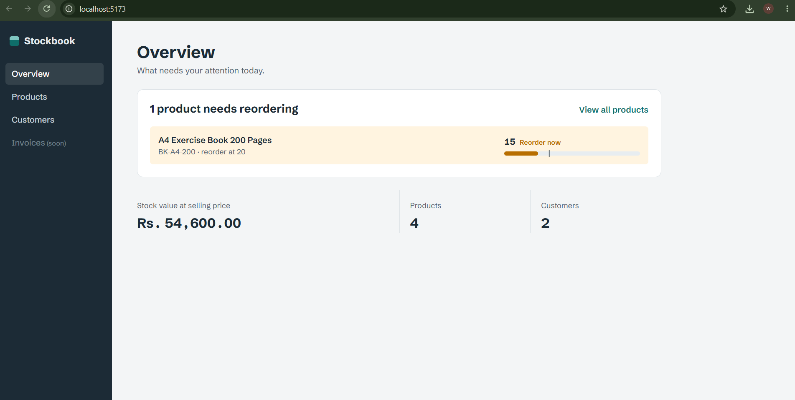
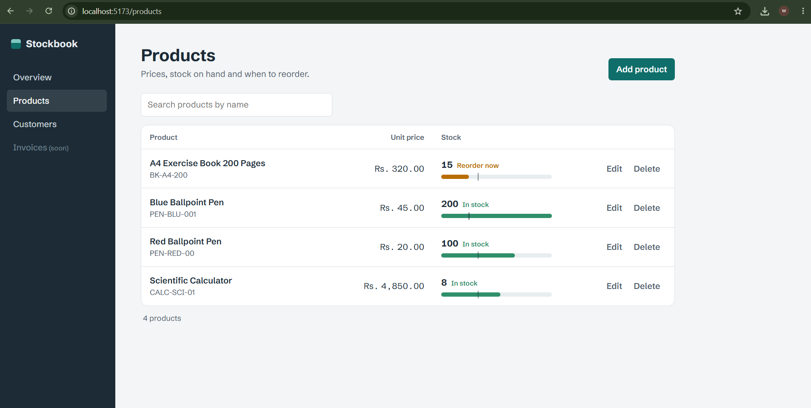

# Stockbook: Invoice & Inventory System

A full-stack app for small businesses to manage **products, stock levels, customers and invoices**.
The backend is a **Spring Boot REST API** and the frontend is a **React** web app.
It uses my accounting background (CBL1, AAT) to model real invoicing and stock rules.




## Tech stack

**Backend**
- **Java 17**, **Spring Boot 3.5** (Web, Data JPA, Validation)
- **MySQL** (production profile) / **H2** in-memory (dev profile and tests)
- **Swagger / OpenAPI** (springdoc) for interactive API docs
- **Lombok**, **JUnit 5 + MockMvc** integration tests

**Frontend** (in [`frontend/`](frontend))
- **React 18** + **Vite**, React Router, plain CSS

## Features (current)

- Product CRUD with unique SKU, price (stored as `BigDecimal`), stock quantity and reorder level
- **Low-stock report**: `GET /api/products/low-stock`
- Customer CRUD with unique email and phone validation
- Pagination, sorting and name search on list endpoints
- Request validation with clear field-level error messages
- Consistent JSON error responses (400, 404, 409) through a global exception handler
- Invoice and InvoiceItem entities (the invoice logic comes next)
- **React frontend:** overview of products that need reordering and total stock value, product and customer management with search and paging, a stock meter for each product, and API validation errors shown under each form field

## Roadmap

- [ ] Create invoices (backend + Invoices page): stock reduces automatically, and the request is rejected if stock is too low
- [ ] Mark invoices paid / cancel (cancelling restores stock)
- [ ] Reports: monthly sales, unpaid invoices, best-selling products
- [ ] Spring Security + JWT with ADMIN and CASHIER roles
- [ ] Unit tests with Mockito
- [ ] Docker + Docker Compose (app + MySQL)
- [ ] GitHub Actions CI and deployment

## Run locally

### Backend

**Option 1: quick start (no database install).** It uses H2 and loads sample data.

```bash
mvn spring-boot:run
```

**Option 2: MySQL**

```sql
CREATE DATABASE inventory_db;
```

```bash
mvn spring-boot:run -Dspring-boot.run.profiles=mysql
# DB_URL, DB_USERNAME and DB_PASSWORD environment variables override the defaults
```

Then open:

- Swagger UI: http://localhost:8080/swagger-ui.html
- H2 console (dev only): http://localhost:8080/h2-console (JDBC URL `jdbc:h2:mem:inventorydb`, user `sa`)

### Frontend

Requires Node.js 18+. Start the backend first, then in a second terminal:

```bash
cd frontend
npm install
npm run dev
```

Open http://localhost:5173. In development, Vite forwards `/api` requests to the backend on port 8080.

## Run tests

```bash
mvn test
```

## API endpoints

| Method | Endpoint | Description |
|---|---|---|
| POST | `/api/products` | Create product |
| GET | `/api/products?search=&page=0&size=20&sort=name,asc` | List / search products |
| GET | `/api/products/low-stock` | Products at or below reorder level |
| GET | `/api/products/{id}` | Get product |
| PUT | `/api/products/{id}` | Update product |
| DELETE | `/api/products/{id}` | Delete product |
| POST | `/api/customers` | Create customer |
| GET | `/api/customers?search=` | List / search customers |
| GET | `/api/customers/{id}` | Get customer |
| PUT | `/api/customers/{id}` | Update customer |
| DELETE | `/api/customers/{id}` | Delete customer |

Example error response:

```json
{
  "timestamp": "2026-10-13T21:45:00",
  "status": 400,
  "error": "Bad Request",
  "message": "Validation failed",
  "path": "/api/products",
  "fieldErrors": { "unitPrice": "Unit price must be greater than 0" }
}
```

## Project structure

```
frontend/         React app (see frontend/README.md)
src/main/java/com/maheesha/inventory
├── config/       OpenAPI config, dev sample data
├── controller/   REST endpoints
├── dto/          Request/response records (entities are never exposed)
├── entity/       JPA entities: Product, Customer, Invoice, InvoiceItem
├── exception/    Custom exceptions + global handler
├── repository/   Spring Data JPA repositories
└── service/      Business logic
```
